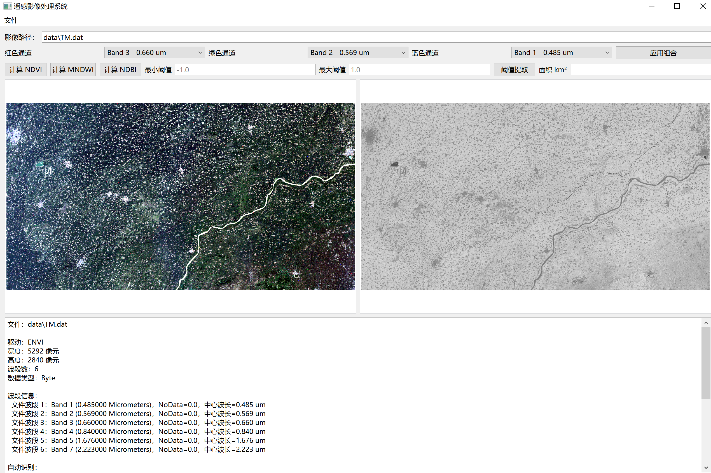

# Python 遥感影像处理工具

一个基于 **Python、GDAL、NumPy、PyQt6 和 SQLite** 的桌面遥感影像处理程序，可完成多波段影像读取、波段组合、遥感指数计算、阈值提取、面积统计和结果保存。

本项目由我根据本科期间与同学合作完成的 Python 课程作业重新整理。原课程项目曾在另一台电脑上运行；当前版本由我重新搭建开发环境，恢复并梳理处理流程，改进路径和波段识别逻辑，并对空间参考、指数结果及面积计算进行了验证。项目保留了课程实践的演进背景，也作为我学习 Python 遥感开发的作品集项目。



## 功能特性

- 使用 GDAL 读取 ENVI、GeoTIFF 等常见栅格格式
- 显示影像尺寸、波段数、数据类型、仿射变换、投影和波段信息
- 自定义 RGB 波段组合，支持真彩色和假彩色显示
- 根据中心波长元数据识别光谱角色，计算 NDVI、MNDWI 和 NDBI
- 处理 NoData，并根据指数上下限提取目标像元
- 根据仿射变换和投影线性单位计算目标区域面积
- 将处理结果保存为带空间参考的 GeoTIFF 或 ENVI 文件
- 将指数类型、阈值、像元数和面积结果写入 SQLite
- 支持滚轮缩放和鼠标拖动查看影像
- 使用项目相对路径，可整体移动项目目录后继续运行

## 技术栈

| 类别 | 技术 |
| --- | --- |
| 开发语言 | Python 3.11 |
| 栅格读写与空间参考 | GDAL / OSR |
| 数值计算 | NumPy |
| 桌面界面 | PyQt6 / Qt Designer |
| 结果存储 | SQLite |
| 环境管理 | Conda |

## 快速开始

### 1. 创建环境

推荐在 Windows 上使用 Miniconda 或 Anaconda，并从 `conda-forge` 安装 GDAL，避免单独配置本地 GDAL 动态库。

```powershell
conda env create -f environment.yml
conda activate remote-sensing-image-tool
```

如果已经创建了本项目使用的 `rs_portfolio` 环境，也可以直接运行：

```powershell
conda activate rs_portfolio
```

### 2. 准备数据

将自己的多波段遥感影像放入 `data/`。测试数据体积较大且来源许可需要单独确认，因此不随公开仓库发布；具体要求见 [`data/README.md`](data/README.md)。

### 3. 启动程序

请先进入项目目录，再运行：

```powershell
python app.py
```

程序启动后，通过“文件 → 打开影像”选择数据，也可以按 `Ctrl+O`。

### 4. 修改界面（可选）

`rs.py` 由 `rs.ui` 生成。使用 Qt Designer 修改界面后执行：

```powershell
pyuic6 rs.ui -o rs.py
python -m py_compile rs.py
```

不要直接在 `rs.py` 中长期维护界面修改，否则重新生成文件时会被覆盖。

## 使用流程

1. 打开多波段遥感影像，检查元数据和空间参考。
2. 选择红、绿、蓝显示通道并应用波段组合。
3. 根据数据具备的光谱波段计算 NDVI、MNDWI 或 NDBI。
4. 输入指数最小值和最大值，执行阈值提取。
5. 检查目标像元数和面积统计结果。
6. 将结果保存为栅格文件，或写入 SQLite 数据库。

## 遥感指数

| 指数 | 公式 | 主要用途 |
| --- | --- | --- |
| NDVI | `(NIR - Red) / (NIR + Red)` | 植被识别与长势分析 |
| MNDWI | `(Green - SWIR1) / (Green + SWIR1)` | 水体增强与提取 |
| NDBI | `(SWIR1 - NIR) / (SWIR1 + NIR)` | 建成区增强 |

程序优先从波段描述或元数据读取中心波长，再识别 Blue、Green、Red、NIR 和 SWIR 等光谱角色，而不是把指数固定到某一种卫星的波段序号。若数据缺少可解析的波长信息，RGB 组合仍可使用，但程序会阻止无法可靠判断波段的指数计算，避免静默产生错误结果。

## 验证情况

当前版本使用一景 Landsat TM ENVI 影像完成了端到端测试：

- 影像尺寸：5292 × 2840 像元
- 数据波段：TM B1、B2、B3、B4、B5、B7
- 坐标参考系：WGS 84 / UTM zone 50N（EPSG:32650）
- 空间分辨率：30 m × 30 m
- 已验证流程：RGB 组合、三类指数计算、阈值提取、NoData 处理、面积统计、空间参考继承、结果保存和 SQLite 入库

面积计算使用仿射变换矩阵行列式获得单个像元面积，并结合投影坐标系的线性单位换算为平方米和平方千米，而不是仅假定所有影像均为固定分辨率。

> 注意：当前验证重点是软件处理链。进行定量遥感分析前，应确认输入像元属于 DN、辐亮度、表观反射率还是地表反射率，并根据具体数据产品完成必要的辐射定标和大气校正。

## 项目结构

```text
remote-sensing-image-tool/
├─ app.py              # 影像处理、显示、保存和数据库逻辑
├─ rs.py               # 由 rs.ui 生成的 PyQt6 界面代码
├─ rs.ui               # Qt Designer 界面源文件
├─ environment.yml     # Conda 环境定义
├─ README.md
├─ screenshots/        # 项目运行截图
├─ data/
│  └─ README.md        # 输入数据说明；大型数据不提交
└─ outputs/
   └─ README.md        # 输出说明；运行结果不提交
```

程序以 `app.py` 所在目录作为项目根目录：文件选择器默认进入 `data/`，处理结果和 SQLite 数据库默认写入 `outputs/`。因此项目文件夹放在不同位置时，不需要修改硬编码的绝对路径。

## 数据与仓库说明

- `.gitignore` 已排除大型遥感影像、金字塔文件、数据库和可重复生成的处理结果。
- 示例截图只用于展示软件界面，不替代原始数据的授权说明。
- 若使用其他数据复现，应根据传感器产品文档核对波段含义、波长、NoData、投影和数据级别。

## 后续计划

- 增加更多传感器元数据的波段识别规则
- 增加指数结果的色带和图例显示
- 增加处理参数与结果记录的导出功能
- 补充自动化测试和小尺寸公开示例数据

## 致谢与说明

本项目原型来自本科 Python 课程作业，由我与同学合作开发；当前仓库是我在原有成果基础上进行的恢复、整理和功能验证版本。仓库用于个人学习记录和求职作品展示。
